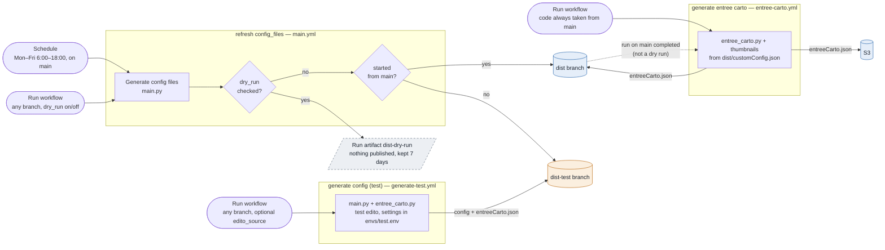

# geoportal-configuration

Generation of configuration JSONs for Geoportal JS APIs

## Dependency install
`pip3 install -r requirements.txt`

## CLI usage
`python main.py key1 key2...`$

Config files are generated in `dist` directory

HTTP requests are sent in parallel: the 5 GetCapabilities of a key and the TMS layer descriptions. The number of simultaneous requests is set by the `CONFIG_MAX_WORKERS` environment variable (default 8, max 20, `1` = sequential).

## Launch web interface
### Without Docker
`python -m flask run --host=0.0.0.0`

### With Docker
`docker build --tag gpconnfig . && docker run gpconfig`

## Use web interface
### Form
Go to the index of the deployed web inteface with a web browser. Example: https://geoportal-configuration.onrender.com/

### API
`curl http://host:port/api?key1,key2,...`

Example: https://geoportal-configuration.onrender.com/api?keys=essentiels

## GitHub Actions workflows

Where the files generated by each workflow end up, depending on the branch the run starts from and on the `dry_run` input:



- Runs that publish on `dist-test` (**refresh config_files** from another branch, **generate config (test)**) share the `generate-config-test` concurrency group, so they never push to `dist-test` at the same time.
- **generate entree carto** also runs after a failed refresh on `main` (`dist` then holds the last complete version), but not after a dry run or a run from another branch.

## Production generation (`refresh config_files`)

The workflow **refresh config_files** (`.github/workflows/main.yml`) runs on a schedule on `main` and can also be started manually (*Actions* > *refresh config_files* > *Run workflow*) from any branch. Where the generated files end up depends on the branch and on the `dry_run` input:

| Branch | `dry_run` unchecked | `dry_run` checked |
|---|---|---|
| `main` (and the schedule) | published on `dist` | nothing published, files in the run *Artifacts* |
| any other branch | published on `dist-test` (`DIST_BRANCH` / `MAX_COMMIT` from `envs/test.env`) | nothing published, files in the run *Artifacts* |

A run from another branch never touches `dist`, and it does not start **generate entree carto**: `entreeCarto.json` already on `dist-test` is kept as is.

## Test generation (`dist-test` branch)

The GitHub Actions workflow **generate config (test)** (`.github/workflows/generate-test.yml`) generates all the configuration files with a **custom editorial configuration** and publishes them on the `dist-test` branch. The production `dist` branch is not touched.

- It uses the **production** GetCapabilities, the same ones as `main.yml`.
- It can only be **started manually**: *Actions* > *generate config (test)* > *Run workflow*. The optional `edito_source` input is either a file path in the repository or a URL. When it is empty, the workflow uses `EDITO_SOURCE` from `envs/test.env`.

`envs/test.env` defines:

| Variable | Role |
|---|---|
| `EDITO_SOURCE` | Default editorial configuration: a file path in the repository (`edito/edito-test.json`) or a URL |
| `DIST_BRANCH` | Branch where the generated files are published (`dist-test`) |
| `MAX_COMMIT` | Maximum number of commits kept on `DIST_BRANCH` (`10`) |

To run the same generation locally:
```sh
EDITO_SOURCE=edito/edito-test.json python generator_entree_carto/entree_carto.py --input=dist/customConfig.json --output=entreeCarto.tmp
```

When `EDITO_SOURCE` is not set, the production edito is used, so the production workflows behave as before.
